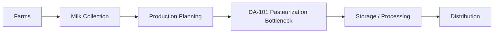
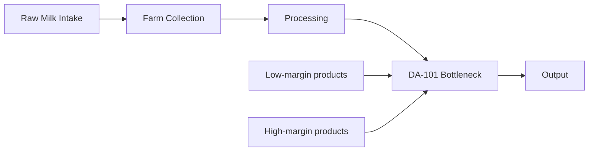
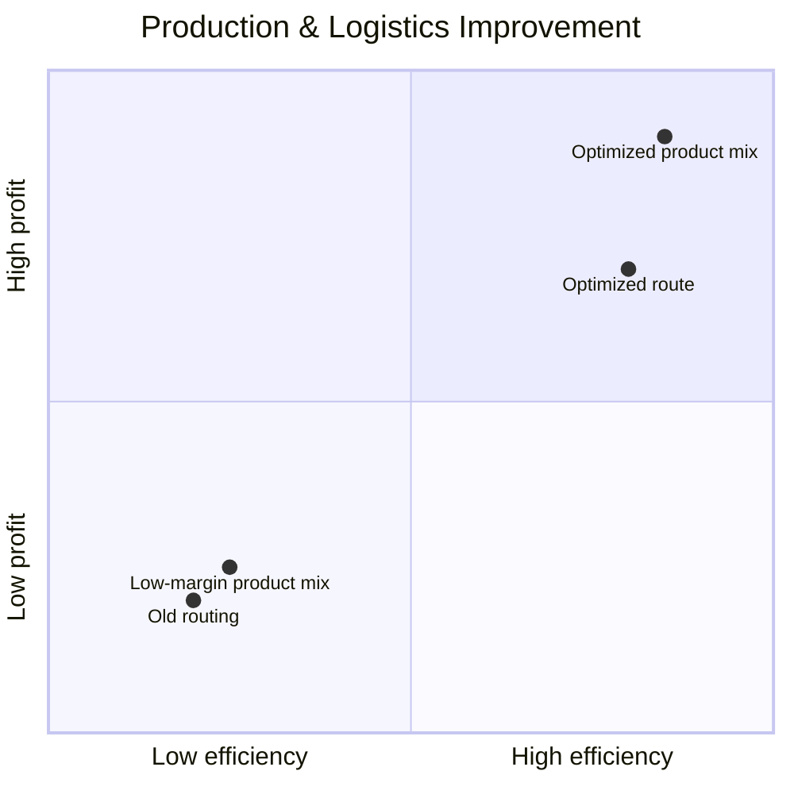
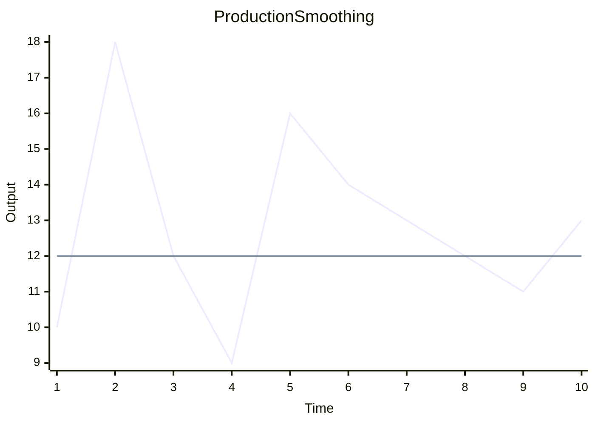

# TINE Brumunddal: Supply Chain & Operations Optimization

[](https://www.nmbu.no/)
[](https://www.nmbu.no/)
[](#)

> A portfolio-ready industrial optimization project for TINE Brumunddal, combining Lean Production, Theory of Constraints, linear programming, heuristic routing, and production leveling to improve dairy supply chain performance.

---

## Project Overview

This project was completed as part of the course IND210 - Driftsledelse (Operations Management) at the Norwegian University of Life Sciences (NMBU). The objective was to analyze and improve a dairy supply chain operating under fluctuating supply, capacity constraints, and transportation complexity.

The challenge was not just moving raw milk efficiently — it was ensuring that the entire production and logistics system generated the highest possible value under real operational limitations.

The project focused on three main decision areas:
- product mix optimization at the bottleneck
- route efficiency for farm collection
- production smoothing to reduce variability and bullwhip effects

---

## Visual Overview

### 1) Dairy supply chain flow



### 2) The bottleneck problem



### 3) Production & Logistics Improvement



This chart illustrates the project’s impact on operational performance. The original system sat in the low-efficiency, low-profit region due to inefficient routing and poor bottleneck allocation. After optimization, both logistics and production decisions shifted toward the high-efficiency, high-profit space.

### 4) Heijunka: production leveling



---

## The Problem

TINE Brumunddal faces a classic industrial operations challenge: fluctuating raw milk supply, limited process capacity, and an increasingly complex logistics network.

### Main issues
- Raw milk intake varies across farms and time periods
- One production step becomes the system bottleneck
- Some products consume scarce bottleneck time without generating competitive margins
- Transportation routes are often inefficient when not optimized
- Supply variability creates bullwhip effects that destabilize planning and inventory

### Why it matters
In a dairy supply chain, even small operational inefficiencies compound quickly. If the wrong products are produced, if routes are poorly planned, or if production is not leveled, costs rise and profitability falls.

This project addresses the business problem by treating the company as a constrained production and logistics system rather than as isolated departments.

---

## What We Solved

The project tackled the problem from three complementary angles.

### 1) Production Optimization with Linear Programming

The first challenge was identifying the real bottleneck in production and determining which products should be prioritized.

We used a linear programming model to optimize the product mix around the DA-101 pasteurization line, which was the limiting process in the system.

#### Objective
Maximize contribution margin while respecting capacity and process constraints.

#### Approach
- Modeled production decisions as a constrained optimization problem
- Identified low-margin products consuming bottleneck time
- Evaluated contribution margin per production hour
- Reallocated scarce bottleneck capacity to higher-value products

#### Result
- Recommendation to reduce or phase out low-margin products such as mellommelk
- Increased daily contribution margin by approximately 9.7%
- Estimated benefit of around 29,625 NOK per day
- Demonstrated substantial annual profit potential

This is a textbook Theory of Constraints application: improve the constraint, not every part of the system equally.

---

### 2) Route Optimization with Heuristics

The second challenge was transportation. Milk had to be collected from many suppliers across a geographically fragmented network.

We implemented a vehicle routing heuristic using the Two-Opt algorithm to reduce total distance and improve truck utilization.

#### Objective
Minimize travel cost and route length while preserving operational feasibility and compliance.

#### Approach
- Optimized farm collection sequences
- Incorporated driver rest requirements and legal constraints
- Reduced unnecessary detours and inefficient routing patterns

#### Result
- Lower total route distance versus baseline routing
- Increased operational efficiency
- Better use of available vehicle capacity
- Maintained compliance with mandatory rest regulations

This shows how logistics optimization can directly improve cost structure and operational performance.

---

### 3) Production Leveling (Heijunka)

The third challenge was variability. Raw milk intake fluctuates, which creates instability and increases the risk of bullwhip effects throughout the chain.

We modeled a Heijunka-style production leveling strategy to smooth output and absorb variation more effectively.

#### Objective
Reduce variability and stabilize production flow despite fluctuating raw input.

#### Approach
- Smoothed production schedules over time
- Diverted surplus milk into storable products when appropriate
- Reduced disruption caused by uneven supply patterns
- Improved inventory and operational planning stability

#### Result
- Reduced volatility across the chain
- Improved production stability
- Better inventory management
- Stronger resilience to supply variability

This is where Lean thinking becomes especially valuable: smoother flow creates less waste and less operational stress.

---

## How It Was Solved

The project combined quantitative methods with practical industrial reasoning.

### Core methodology
- Linear programming for product mix and bottleneck allocation
- Heuristic optimization for routing problems
- Simulation-based analysis for production leveling
- Lean principles and Theory of Constraints for decision-making logic

### Decision logic
Rather than asking, "How can we produce more?", the project asked:
- What is the true constraint?
- Which products create the most value per bottleneck hour?
- How can transportation be designed to reduce waste?
- How can variability be reduced so the system runs more smoothly?

This reframing is a key lesson in operations management: optimal performance comes from managing constraints and flow, not simply increasing output.

---

## What We Learned

This project reinforced several important lessons in industrial and supply chain management.

### 1. Bottlenecks define system performance
A production system is only as strong as its constraint. Improving non-bottleneck processes alone does not guarantee better outcomes.

### 2. Product mix matters more than total volume
Producing more of the wrong product can destroy margin. The right product mix often creates more value than simply producing more.

### 3. Logistics is a strategic lever
Transportation is not only a cost item — it affects quality, timing, reliability, and service performance.

### 4. Variability is expensive
Unstable demand and supply create ripple effects that propagate through the system. Smoothing and buffering strategies reduce operational strain.

### 5. Data and optimization create decisions, not just insights
The value of the project came from translating mathematical models into operational action.

---

## Technologies Used

| Component | Technology |
|-----------|------------|
| Language | Python |
| Data Processing | Pandas, NumPy |
| Optimization | SciPy, HiGHS |
| Routing & Distance Modeling | Google Routes API |
| Visualization | GeoJSON, charts, plots |
| Domain Focus | Agro-industrial supply chain, route optimization, production leveling |

### Why these technologies?
- Python enabled rapid modeling and analysis
- Pandas and NumPy handled large operational datasets efficiently
- SciPy and HiGHS solved optimization problems reliably
- Google Routes API supported realistic logistics planning
- Visualization tools made the operational story easier to explain and present

---

## Project Structure

```text
Industrial-management-IND210/
├── README.md                          # Project documentation
├── Report.pdf                         # Final comprehensive report
├── Report.docx                        # Source report document
├── .gitignore                         # Git configuration
├── requirements.txt                   # Python dependencies
├── LICENSE                            # Project license
│
├── models/                            # Optimization and simulation models
│   ├── production_optimization.py     # Linear programming model
│   ├── route_optimization.py          # Routing heuristic implementation
│   └── heijunka_simulation.py         # Production leveling model
│
├── data/                              # Input datasets
│   ├── production_capacity.csv        # Equipment and bottleneck data
│   ├── farm_locations.csv             # Farm geographic data
│   ├── milk_intake_variance.csv       # Supply variability patterns
│   └── product_margins.csv           # Contribution margin data
│
├── results/                           # Output files
│   ├── production_analysis.csv        # Optimization results
│   ├── optimal_routes.geojson         # Route visualization
│   ├── bullwhip_analysis.png          # Production smoothing plot
│   └── summary_report.txt             # Executive summary
│
└── docs/                              # Documentation
    ├── methodology.md                # Detailed methodology
    ├── assumptions.md                # Model assumptions
    └── references.md                 # Academic and industrial references
```

---

## Key Metrics and Business Impact

| Metric | Value | Unit |
|--------|-------|------|
| Contribution Margin Increase | 9.7% | % daily |
| Margin Impact | ~29,625 | NOK/day |
| Annual Potential | €10.8M+ | Revenue potential |
| Route Efficiency | Improved | vs. baseline |
| Bullwhip Effect | Reduced | Operational stability |
| Regulatory Compliance | 100% | Driver and route adherence |

### Business value delivered
- Increased profitability through bottleneck-focused optimization
- Reduced logistics costs and travel waste
- Better production stability under raw material fluctuations
- Stronger operational planning and reduced risk
- Scalable framework for similar dairy or agro-industrial supply chains

---

## Project Team

| Member | Role |
|--------|------|
| Mehdi Jamali | Lead analyst, linear programming |
| Daniel Yang Tsan | Route optimization specialist |
| Oliver Tschudi Madsen | Production simulation expert |
| Helena Liepina Vollestad | Supply chain researcher |
| Victoria Wallin | Data analyst and visualization |

---

## Documentation

- [Full Report](./Report.pdf) — Comprehensive technical report
- [Methodology](./docs/methodology.md) — Detailed model descriptions
- [Assumptions](./docs/assumptions.md) — Explicit assumptions and constraints
- [References](./docs/references.md) — Academic and industry sources

---

## Portfolio Summary

This project demonstrates the ability to combine operations research, data analysis, and business-oriented decision-making in a realistic industrial setting. It is a strong example of applying quantitative methods to solve meaningful problems in production, transportation, and supply chain management.

It reflects a practical skill set relevant to:
- Supply chain engineering
- Operations analytics
- Industrial optimization
- Process improvement
- Strategic decision support

---

## License

This project is licensed under the MIT License. See [LICENSE](./LICENSE) for details.

---

## Contributing

Contributions are welcome. To contribute:

1. Fork the repository
2. Create a feature branch (`git checkout -b feature/YourFeature`)
3. Commit your changes (`git commit -m 'Add feature'`)
4. Push to the branch (`git push origin feature/YourFeature`)
5. Open a Pull Request

---

## Contact

**Project Lead:** Mehdi Jamali  
**Repository:** [Mehdij1511/Industrial-management-IND210](https://github.com/Mehdij1511/Industrial-management-IND210)  
**Course:** IND210 - Operations Management (NMBU)

---

## Acknowledgments

- TINE Brumunddal — for providing operational context and data
- NMBU Faculty — for academic guidance and support
- Course instructors — for mentoring quantitative optimization approaches

---

**Last Updated:** May 2026  
**Status:** Project Complete ✓
